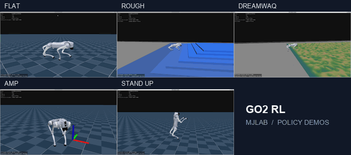

# Go2 RL MjLab

[中文](README_zh.md) | English

A reinforcement learning training repository for **Unitree Go2**, built on **mjlab**, **MuJoCo Warp** and **RSL-RL**. It integrates locomotion, motion priors, bipedal standing, backflips and right-front-foot manipulation. The original G1 motion-tracking tasks are also retained.

## Training results

Simulation rollouts of five trained policies: Flat, Rough, DreamWaQ, AMP and StandUp.



## Environment requirements

| Component | Tested configuration |
| --- | --- |
| OS | Ubuntu 22.04; Windows with WSL2 Ubuntu 22.04 is also supported |
| Python | 3.11 |
| GPU | NVIDIA GPU with a CUDA-compatible driver |
| PyTorch | 2.8.0 + CUDA 12.6 |
| Simulation | mjlab 1.2.0, MuJoCo / mujoco-warp 3.5.0, Warp 1.12.0 |
| RL library | RSL-RL 5.0.1 |

The default training configurations use 2,048–4,096 parallel environments and were run on an RTX 4090 with 24 GB VRAM. Reduce the environment count for smaller GPUs. Native interactive playback requires a graphical desktop or working WSLg; headless training uses EGL. Isaac Lab is not required.

```bash
conda create -n go2_rl_mjlab python=3.11 -y
conda activate go2_rl_mjlab
git clone https://github.com/cjisoad/go2_rl_mjlab.git
cd go2_rl_mjlab
python -m pip install torch==2.8.0 torchvision==0.23.0 --index-url https://download.pytorch.org/whl/cu126
python -m pip install -r requirements-training.txt
python -m pip install -e . --no-deps
python scripts/list_envs.py
```

Dependency versions are pinned in [requirements-training.txt](requirements-training.txt). For the existing local WSL setup, activate `cjisoad_mjlab` instead of creating another environment.

## Integrated methods

| Method | Task ID | Description | Iterations | Parallel environments |
| --- | --- | --- | ---: | ---: |
| Flat | `Unitree-Go2-Flat` | Flat-ground velocity tracking | 2000 | 4096 |
| Rough | `Unitree-Go2-Rough` | Rough-terrain velocity tracking | 3000 | 4096 |
| DreamWaQ | `Unitree-Go2-DreamWaQ` | History encoder, latent estimation and rough-terrain locomotion | 5000 | 4096 |
| AMP | `Unitree-Go2-AMP` | Adversarial motion prior and velocity tracking | 10000 | 2048 |
| StandUp V2.1 | `Unitree-Go2-StandUp` | Hind-leg bipedal standing and locomotion | 6000 | 4096 |
| Backflip V1.6 | `Unitree-Go2-Backflip-V1.6` | Standing backflip | 1000 | 4096 |
| Quad Pedipulation | `Unitree-Go2-Quad-Pedipulation` | DreamWaQ-based locomotion and right-front-foot manipulation | 5000 | 4096 |
| Biped Pedipulation | `Unitree-Go2-Biped-Pedipulation` | StandUp-based bipedal locomotion and right-front-foot manipulation | 6000 | 4096 |

The two pedipulation tasks use a six-dimensional command: body velocity `(vx, vy, yaw_rate)` plus the right-front-foot target position `(x, y, z)` in the body frame. Actor observations do not require measured ground-truth foot positions or contact forces. See [task design](docs/pedipulation.md) for observations and rewards.

These are mjlab implementations/adaptations; existing Isaac Lab checkpoints are not interchangeable. G1 tracking remains available through `python scripts/list_envs.py` and requires a separately supplied motion `.npz` file.

## Start training

Activate the environment and run commands from the repository root. Each command below uses the iteration count and environment count in the table above; run the command for the task you want to train.

```bash
# Flat
MUJOCO_GL=egl python scripts/train.py Unitree-Go2-Flat
# Rough
MUJOCO_GL=egl python scripts/train.py Unitree-Go2-Rough
# DreamWaQ
MUJOCO_GL=egl python scripts/train.py Unitree-Go2-DreamWaQ
# AMP
MUJOCO_GL=egl python scripts/train.py Unitree-Go2-AMP
# StandUp V2.1
MUJOCO_GL=egl python scripts/train.py Unitree-Go2-StandUp
# Backflip V1.6
MUJOCO_GL=egl python scripts/train.py Unitree-Go2-Backflip-V1.6
# Quad Pedipulation
MUJOCO_GL=egl python scripts/train.py Unitree-Go2-Quad-Pedipulation
# Biped Pedipulation
MUJOCO_GL=egl python scripts/train.py Unitree-Go2-Biped-Pedipulation
```

For a smaller GPU, override the environment count; training iterations can also be overridden:

```bash
MUJOCO_GL=egl python scripts/train.py Unitree-Go2-DreamWaQ \
  --env.scene.num-envs 1024 --agent.max-iterations 5000
```

Train all eight tasks sequentially, one task at a time:

```bash
python scripts/train_sequence.py
```

The queue order is Flat → Rough → Backflip → StandUp → DreamWaQ → AMP → Quad Pedipulation → Biped Pedipulation. It saves progress and stops on failure. `--resume` skips completed tasks and starts the unfinished task from scratch. See [remote training and monitoring](docs/remote-training.md).

Checkpoints, TensorBoard events and training configuration files are saved under `logs/rsl_rl/`. Local training logs and checkpoints are excluded from Git.

### Interactive policy playback

Replace the task ID and checkpoint path with a matching trained policy:

```bash
python scripts/play.py Unitree-Go2-DreamWaQ \
  --checkpoint-file /absolute/path/model_4999.pt \
  --num-envs 1 --viewer native --keyboard True
```

| Keys | Action |
| --- | --- |
| W / S, A / D | Increase/decrease forward and lateral velocity |
| Q / E | Increase/decrease yaw rate |
| X | Zero velocity commands |
| I / K, J / L, U / O | Adjust right-front-foot target along body X, Y and Z; pedipulation tasks only |
| H | Return the right front foot; pedipulation tasks only |
| Space / Enter / Esc | Pause / reset / close |

Velocity and foot commands persist after releasing a key. Keyboard playback of Rough, DreamWaQ and Quad Pedipulation uses a smaller strip containing seven terrain types by default. Use `--play-terrain original` for the original map. Backflip playback is autonomous: omit `--keyboard True`. More details: [keyboard controls](docs/keyboard-control.md), [terrain strip](docs/play-strip.md).

## Acknowledgements and license

Based on [Unitree RL MjLab](https://github.com/unitreerobotics/unitree_rl_mjlab), [mjlab](https://github.com/mujocolab/mjlab) and [RSL-RL](https://github.com/leggedrobotics/rsl_rl). This repository retains the upstream [Apache 2.0 license](LICENCE). Method source records, migration notes and additional notices are kept in [docs/migration](docs/migration) and the corresponding task directories.
