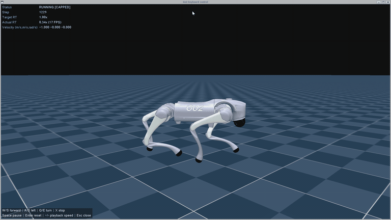
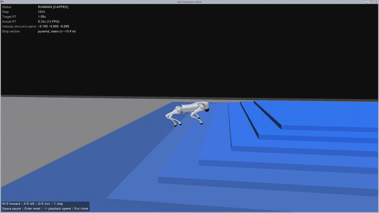
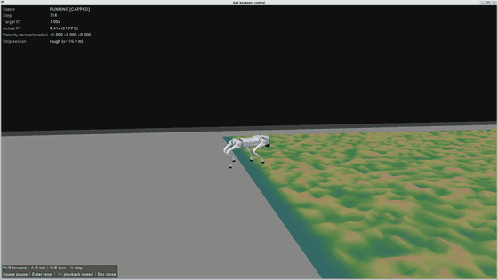
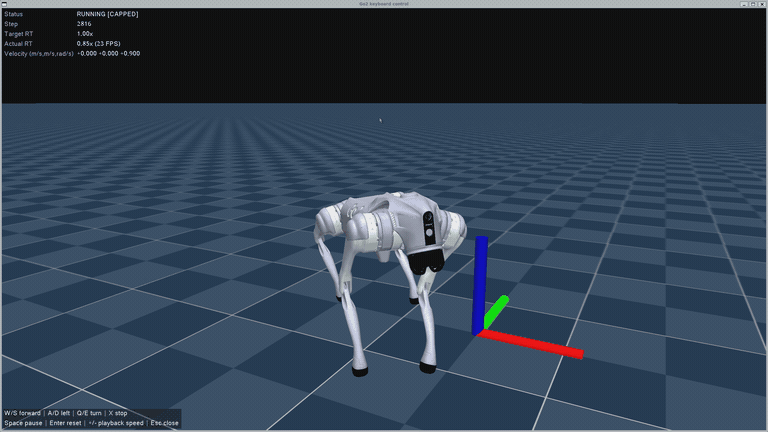
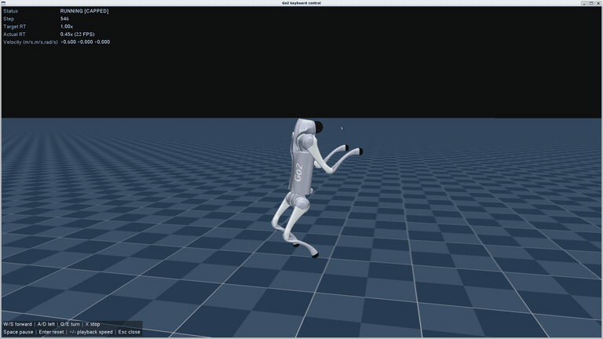

# Go2 RL MjLab

中文 | [English](README.md)

基于 **mjlab**、**MuJoCo Warp** 和 **RSL-RL** 的 **Unitree Go2 强化学习训练仓库**，集成行走、运动先验、双足站立、后空翻和右前腿操作任务，同时保留原有 G1 动作跟踪代码。

## 训练效果

以下为训练后策略在仿真中的演示，以 GIF 动图自动循环播放。目前展示以下五个任务。

**Flat**



**Rough**



**DreamWaQ**



**AMP**



**StandUp**



## 环境要求

| 组件 | 已验证配置 |
| --- | --- |
| 操作系统 | Ubuntu 22.04，也支持 Windows + WSL2 Ubuntu 22.04 |
| Python | 3.11 |
| 显卡 | NVIDIA GPU，安装兼容 CUDA 的驱动 |
| PyTorch | 2.8.0 + CUDA 12.6 |
| 仿真 | mjlab 1.2.0、MuJoCo / mujoco-warp 3.5.0、Warp 1.12.0 |
| 强化学习库 | RSL-RL 5.0.1 |

默认训练配置使用 2048–4096 个并行环境，已在 24 GB 显存的 RTX 4090 上训练。显存较小时请降低并行环境数。原生窗口播放需要图形桌面或可用的 WSLg；无窗口训练使用 EGL。无需安装 Isaac Lab。

```bash
conda create -n go2_rl_mjlab python=3.11 -y
conda activate go2_rl_mjlab
git clone https://github.com/cjisoad/go2_rl_mjlab.git
cd go2_rl_mjlab
python -m pip install torch==2.8.0 torchvision==0.23.0 --index-url https://download.pytorch.org/whl/cu126
python -m pip install -r requirements-training.txt
python -m pip install -e . --no-deps
python scripts/list_envs.py
```

依赖版本见 [requirements-training.txt](requirements-training.txt)。使用已有的本机 WSL 环境时，直接激活 `cjisoad_mjlab` 即可，无需另建环境。

## 集成方法

| 方法 | Task ID | 简介 | 默认训练轮数 | 并行环境数 |
| --- | --- | --- | ---: | ---: |
| Flat | `Unitree-Go2-Flat` | 平地速度跟踪 | 2000 | 4096 |
| Rough | `Unitree-Go2-Rough` | 粗糙地形速度跟踪 | 3000 | 4096 |
| DreamWaQ | `Unitree-Go2-DreamWaQ` | 历史观测、隐变量估计与复杂地形行走 | 5000 | 4096 |
| AMP | `Unitree-Go2-AMP` | 运动先验与速度跟踪 | 10000 | 2048 |
| StandUp V2.1 | `Unitree-Go2-StandUp` | 后腿双足站立与运动 | 6000 | 4096 |
| Backflip V1.6 | `Unitree-Go2-Backflip-V1.6` | 原地后空翻 | 1000 | 4096 |
| Quad Pedipulation | `Unitree-Go2-Quad-Pedipulation` | 基于 DreamWaQ，四足运动与右前腿操作 | 5000 | 4096 |
| Biped Pedipulation | `Unitree-Go2-Biped-Pedipulation` | 基于 StandUp，双足运动与右前腿操作 | 6000 | 4096 |

两个 Pedipulation 任务均使用六维命令：机身速度 `(vx, vy, yaw_rate)` 加机身坐标系下右前脚目标位置 `(x, y, z)`。Actor 观测不依赖脚端真实位置或接触力测量。观测与奖励设计见 [右前腿操作任务说明](docs/pedipulation.md)。

这些方法已实现或适配到 mjlab，不能直接使用 Isaac Lab 的策略检查点。保留的 G1 Tracking 任务可通过 `python scripts/list_envs.py` 查看，训练时需另外提供动作 `.npz` 文件。

## 启动训练

激活环境后，在仓库根目录执行对应任务的命令。以下命令使用上表中的默认轮数和并行环境数，选择需要的任务运行即可。

```bash
# Flat
MUJOCO_GL=egl python scripts/train.py Unitree-Go2-Flat
# Rough
MUJOCO_GL=egl python scripts/train.py Unitree-Go2-Rough
# DreamWaQ
MUJOCO_GL=egl python scripts/train.py Unitree-Go2-DreamWaQ
# AMP
MUJOCO_GL=egl python scripts/train.py Unitree-Go2-AMP
# StandUp V2.1
MUJOCO_GL=egl python scripts/train.py Unitree-Go2-StandUp
# Backflip V1.6
MUJOCO_GL=egl python scripts/train.py Unitree-Go2-Backflip-V1.6
# Quad Pedipulation
MUJOCO_GL=egl python scripts/train.py Unitree-Go2-Quad-Pedipulation
# Biped Pedipulation
MUJOCO_GL=egl python scripts/train.py Unitree-Go2-Biped-Pedipulation
```

显存较小时，可以减少并行环境数；训练轮数也可自行覆盖：

```bash
MUJOCO_GL=egl python scripts/train.py Unitree-Go2-DreamWaQ \
  --env.scene.num-envs 1024 --agent.max-iterations 5000
```

按照指定顺序依次训练全部八个任务：

```bash
python scripts/train_sequence.py
```

队列顺序为 Flat → Rough → Backflip → StandUp → DreamWaQ → AMP → Quad Pedipulation → Biped Pedipulation，每次只训练一个任务。队列持久保存进度，遇到失败会停止。`--resume` 跳过已完成任务，并从头训练尚未完成的任务。远程启动与查询方式见 [服务器训练说明](docs/remote-training.md)。

模型检查点、TensorBoard 日志和训练配置保存在 `logs/rsl_rl/` 下。本机训练日志与检查点不随 Git 提交。

### 键盘测试策略

将任务名称和检查点路径替换为对应策略：

```bash
python scripts/play.py Unitree-Go2-DreamWaQ \
  --checkpoint-file /absolute/path/model_4999.pt \
  --num-envs 1 --viewer native --keyboard True
```

| 按键 | 功能 |
| --- | --- |
| W / S、A / D | 增减前进速度和横移速度 |
| Q / E | 增减转向角速度 |
| X | 机身速度命令归零 |
| I / K、J / L、U / O | 沿机身 X、Y、Z 轴调整右前脚目标，仅用于 Pedipulation 任务 |
| H | 右前脚放回，仅用于 Pedipulation 任务 |
| 空格 / Enter / Esc | 暂停 / 重置 / 关闭 |

松开按键后命令保持。Rough、DreamWaQ 和 Quad Pedipulation 在键盘模式下默认使用包含七类地形的小型长条地图；添加 `--play-terrain original` 可使用原始地图。后空翻策略自主执行动作，播放时省略 `--keyboard True`。详见 [键盘控制](docs/keyboard-control.md) 和 [长条测试地形](docs/play-strip.md)。

## 致谢与许可证

本仓库基于 [Unitree RL MjLab](https://github.com/unitreerobotics/unitree_rl_mjlab)、[mjlab](https://github.com/mujocolab/mjlab) 和 [RSL-RL](https://github.com/leggedrobotics/rsl_rl)。保留上游 [Apache 2.0 许可证](LICENCE)。方法来源、迁移记录及额外许可声明见 [docs/migration](docs/migration) 和对应任务目录。
